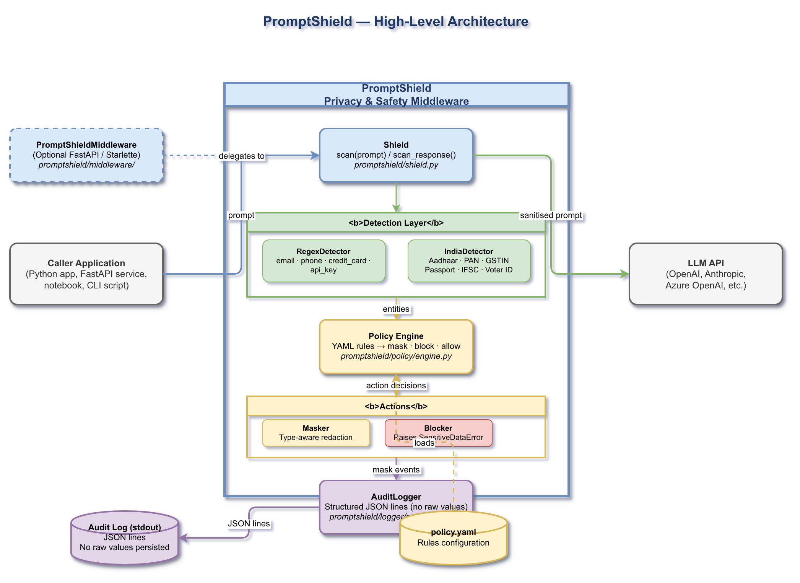
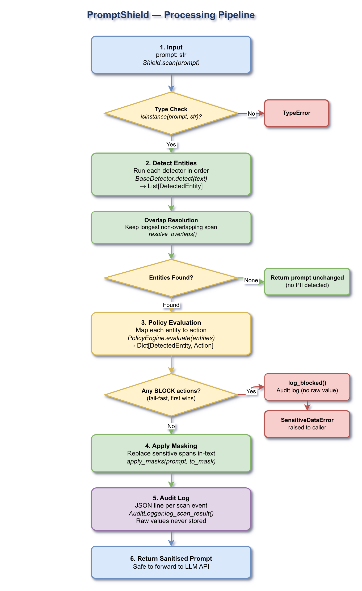
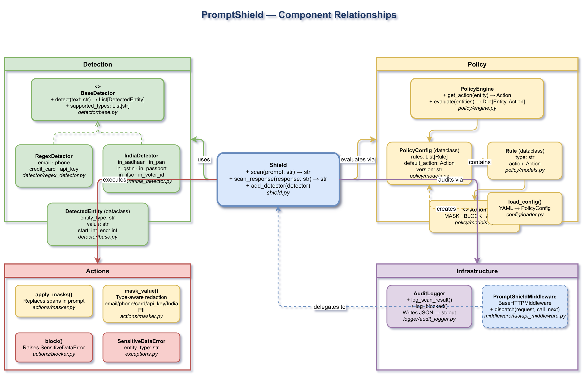

# PromptVeil — Project Summary

## 1. Executive Summary

PromptVeil is a **Python middleware library** (v0.1.0) that intercepts prompts *before* they reach a Large Language Model (LLM) API, detects sensitive personally identifiable information (PII) and secrets, and applies configurable privacy policies (mask, block, or allow). It produces structured JSON audit logs for compliance without persisting raw sensitive values.

The 0.1.0 release includes **confidence-based policy thresholds** (per-rule minimum confidence); **rich scan results** with probabilistic risk scoring (`scan_detailed()`); **jurisdiction compliance profiles** (`india_dpdpa`, `eu_gdpr`, `us_hipaa`) loadable by a single YAML key; a **reversible pseudonymization vault** (`scan_with_vault()`) that replaces PII with stable `<TYPE_N>` tokens restorable after LLM response; and **framework-native adapters** for OpenAI (`wrap_openai`) and LangChain (`get_langchain_callback`). US-specific PII detection (SSN, US Passport, EIN) has been added via `USDetector`.

---

## 2. Architecture Overview



PromptVeil sits between the **caller application** and the **LLM API**. The caller invokes `Shield.scan(prompt)`, which runs the detection pipeline, evaluates results against a YAML-driven policy, applies masking or blocking, emits a structured JSON audit log to stdout, and returns the sanitised string. The optional `PromptVeilMiddleware` wraps FastAPI/Starlette applications to intercept POST request bodies transparently.

### System Boundaries

| Boundary | Description |
|---|---|
| **Caller Application** | Any Python app, FastAPI service, notebook, or CLI script that calls `Shield.scan()` |
| **PromptVeil** | Core library — detection, policy, actions, logging (this project) |
| **LLM API** | Downstream target: OpenAI, Anthropic, Azure OpenAI, etc. (not part of this project) |
| **policy.yaml** | YAML configuration file that drives the policy rules (supports `profile:` key) |
| **Audit Log (stdout)** | Structured JSON lines emitted for each scan event; raw values never stored |
| **PseudonymVault** | In-process session store for reversible `<TYPE_N>` tokens |
| **Framework Adapters** | Thin wrappers for OpenAI SDK and LangChain that intercept calls transparently |

---

## 3. Processing Pipeline



`Shield.scan(prompt)` executes the following steps in strict order:

### Step-by-Step Flow

**Step 1 — Input Validation**
`Shield.scan()` receives a `prompt: str`. If the argument is not a string, a `TypeError` is raised immediately before any processing begins.

**Step 2 — Entity Detection**
All registered `BaseDetector` instances are run against the prompt in sequence. Each detector returns a `List[DetectedEntity]`. Each entity now carries a `confidence: float` (default `1.0`) representing detection certainty. Entities from all detectors are collected, then `_resolve_overlaps()` deduplicates them by keeping the longest non-overlapping span at each position. If no entities are found, the original prompt is returned unchanged.

**Step 3 — Policy Evaluation**
`PolicyEngine.evaluate(entities)` maps each detected entity to an `Action` (`MASK`, `BLOCK`, or `ALLOW`) by looking up the entity type in the rule map. If the entity's `confidence` is below the rule's `min_confidence` threshold, the rule is skipped and `default_action` applies. The result is a `Dict[DetectedEntity, Action]`.

**Step 4 — Block (Fail-Fast)**
Before any masking occurs, the engine iterates through evaluated entities and checks for any `BLOCK` actions. The first `BLOCK` entity triggers `AuditLogger.log_blocked()` (records entity type, no raw value) and then `block()` raises a `SensitiveDataError` immediately. The prompt is never forwarded to the LLM.

**Step 5 — Apply Masking**
Entities resolved to `MASK` are collected. `apply_masks(prompt, to_mask)` rebuilds the string by replacing each sensitive span with a type-aware redacted value from `mask_value()`. Replacements are applied right-to-left by position so earlier offsets remain valid.

**Step 6 — Audit Logging**
`AuditLogger.log_scan_result()` writes a JSON line to stdout recording the event: timestamp, prompt length, number of detections, entity types, actions applied, and masked previews. Raw values are never logged.

**Step 7 — Return**
The sanitised string is returned to the caller, ready to forward to the LLM API.

### FastAPI Middleware Flow

When `PromptVeilMiddleware` is configured, it wraps `dispatch()` around every POST request with `application/json` content. It decodes the body, extracts the configured `prompt_field`, calls `shield.scan()`, and either rewrites the request with the sanitised value (mask path) or returns a `400 Bad Request` JSON response immediately (block path). Non-JSON bodies and non-POST requests are forwarded untouched.

---

## 4. Core Components



### Detection Layer

| Class / Symbol | File | Responsibility |
|---|---|---|
| `BaseDetector` (ABC) | `detector/base.py` | Abstract base; defines `detect(text) → List[DetectedEntity]` and `supported_types` |
| `DetectedEntity` (dataclass) | `detector/base.py` | Immutable record: `entity_type`, `value`, `start`, `end`, `confidence` (default `1.0`) |
| `RegexDetector` | `detector/regex_detector.py` | Compiled regex patterns for `email`, `phone`, `credit_card`, `api_key`; overlap resolution |
| `IndiaDetector` | `detector/india_detector.py` | India-specific PII: `in_aadhaar` (Verhoeff checksum), `in_pan`, `in_phone`, `in_passport`, `in_voter_id`, `in_ifsc`, `in_gstin` |
| `USDetector` | `detector/us_detector.py` | US-specific PII: `ssn` (segment-validated), `us_passport` (1 alpha + 8 digits), `us_ein` (XX-XXXXXXX) |

### Policy Layer

| Class / Symbol | File | Responsibility |
|---|---|---|
| `Action` (StrEnum) | `policy/models.py` | Values: `MASK`, `BLOCK`, `ALLOW` |
| `Rule` (dataclass) | `policy/models.py` | Maps `type: str` → `action: Action`; optional `min_confidence: float` (default `0.0`) |
| `PolicyConfig` (dataclass) | `policy/models.py` | Holds `rules: List[Rule]`, `default_action`, `version` |
| `PolicyEngine` | `policy/engine.py` | O(1) rule lookup; confidence-aware `get_action()`, `evaluate()` |
| `load_config()` | `config/loader.py` | Reads and validates YAML → `PolicyConfig`; rejects unknown actions |
| `load_config_with_profile()` | `config/loader.py` | Extends `load_config` with `profile:` YAML key support; returns `(PolicyConfig, detectors∨None)` |

### Actions Layer

| Function | File | Responsibility |
|---|---|---|
| `apply_masks(text, entities)` | `actions/masker.py` | Rebuilds prompt with all masked spans substituted |
| `mask_value(value, entity_type)` | `actions/masker.py` | Dispatches to per-type masker (email: `j***@domain.com`, phone: `***-***-5309`, card: `****-****-****-1111`, api_key: `sk-a...7890`) |
| `block(entity)` | `actions/blocker.py` | Always raises `SensitiveDataError` |

### Infrastructure Layer

| Class | File | Responsibility |
|---|---|---|
| `AuditLogger` | `logger/audit_logger.py` | Structured JSON lines to stdout; raw values never stored |
| `PromptVeilMiddleware` | `middleware/fastapi_middleware.py` | Starlette `BaseHTTPMiddleware`; intercepts POST bodies, rewrites or blocks |
| `Shield` | `shield.py` | Central orchestrator: wires detection → policy → actions → logging; exposes `scan`, `scan_detailed`, `scan_with_vault` |
| `SensitiveDataError` | `exceptions.py` | Raised on block; carries `entity_type` for caller error handling |
| `ConfigurationError` | `exceptions.py` | Raised on invalid `Shield` construction or bad YAML |

### Results Layer (new in v0.1.0)

| Class / Symbol | File | Responsibility |
|---|---|---|
| `ScanResult` (dataclass) | `results.py` | Frozen: `safe_text`, `entities`, `risk_score`, `risk_level`, `was_mutated` |
| `EntityResult` (dataclass) | `results.py` | Per-entity: `entity_type`, `action`, `start`, `end`, `masked_value`, `confidence` |
| `_compute_risk_score()` | `results.py` | Probabilistic union of per-entity weights; confidence and action both scale contribution |
| `_risk_level()` | `results.py` | Thresholds: NONE=0.0, LOW<0.30, MEDIUM<0.60, HIGH<0.85, CRITICAL≥0.85 |

### Profiles Layer (new in v0.1.0)

| Symbol | File | Responsibility |
|---|---|---|
| `Profile` (dataclass) | `profiles/base.py` | Bundles `name`, `policy: PolicyConfig`, `detectors: List[BaseDetector]` |
| `load_profile(name)` | `profiles/__init__.py` | Factory; raises `ConfigurationError` for unknown names |
| `available_profiles()` | `profiles/__init__.py` | Returns sorted list of registered profile names |
| `india_dpdpa` | `profiles/india_dpdpa.py` | India DPDPA rules + `RegexDetector` + `IndiaDetector` |
| `eu_gdpr` | `profiles/eu_gdpr.py` | EU GDPR rules + `RegexDetector` |
| `us_hipaa` | `profiles/us_hipaa.py` | US HIPAA rules + `RegexDetector` + `USDetector` |

### Vault & Adapters (new in v0.1.0)

| Class / Symbol | File | Responsibility |
|---|---|---|
| `PseudonymVault` | `vault.py` | Thread-safe; mints `<TYPE_N>` tokens; `pseudonymize()`, `restore()`, `get_token()`, `clear()` |
| `wrap_openai(client, shield, vault=None)` | `adapters/openai_adapter.py` | Patches `client.chat.completions.create` in-place; optional vault support |
| `get_langchain_callback()` | `adapters/langchain_adapter.py` | Factory returning a `BaseCallbackHandler` class; implements `on_llm_start` + `on_chat_model_start` |

---

## 5. API Contracts and Message Schemas

### `Shield` Constructor

| Parameter | Type | Default | Description |
|---|---|---|---|
| `config_path` | `str \| Path` | `None` | Path to a YAML policy file |
| `config` | `PolicyConfig` | `None` | Pre-built config object (alternative to `config_path`) |
| `detectors` | `List[BaseDetector]` | `None` | Explicit detector list; overrides profile detectors when supplied |
| `logger` | `AuditLogger` | `AuditLogger()` | Custom audit logger |

Exactly one of `config_path` or `config` must be provided. When using `config_path` with a `profile:` YAML key and no explicit `detectors`, the profile’s detector list is activated automatically.

### `Shield.scan(prompt)` / `Shield.scan_response(response)`

| Parameter | Type | Description |
|---|---|---|
| `prompt` | `str` | Raw input text to evaluate |

**Returns:** `str` — Sanitised string with sensitive values masked.  
**Raises:** `SensitiveDataError` if a `block` rule fires; `TypeError` if `prompt` is not a string.

### `Shield.scan_detailed(prompt)` *(new in v0.1.0)*

Same pipeline as `scan()`, but returns a `ScanResult` instead of a plain string.

| Field | Type | Description |
|---|---|---|
| `safe_text` | `str` | Sanitised prompt |
| `entities` | `tuple[EntityResult]` | Per-entity detail (type, action, position, masked value, confidence) |
| `risk_score` | `float` | Probabilistic aggregate risk, 0.0–1.0 |
| `risk_level` | `str` | NONE / LOW / MEDIUM / HIGH / CRITICAL |
| `was_mutated` | `bool` | `True` if any masking was applied |

### `Shield.scan_with_vault(prompt, vault=None)` *(new in v0.1.0)*

Replaces each masked entity with a stable `<TYPE_N>` token. Returns `(pseudonymized_str, vault)`.

| Parameter | Type | Description |
|---|---|---|
| `prompt` | `str` | Raw input text |
| `vault` | `PseudonymVault \| None` | Reuse an existing vault for cross-turn consistency; creates a new one if `None` |

### `PolicyConfig` Schema

```yaml
version: "1.0"
default_action: allow    # mask | block | allow

# Optional: activate a jurisdiction profile
# profile: india_dpdpa   # or eu_gdpr | us_hipaa

rules:
  - type: <entity_type>    # string label e.g. "email"
    action: <action>       # mask | block | allow
    min_confidence: 0.8    # optional float 0.0–1.0; default 0.0
```

When `profile:` is set, its rules are merged first; explicit `rules:` entries override matching types.

### `DetectedEntity` Schema

| Field | Type | Description |
|---|---|---|
| `entity_type` | `str` | Category label, e.g. `"email"`, `"in_aadhaar"` |
| `value` | `str` | Exact matched substring |
| `start` | `int` | Inclusive start index in source text |
| `end` | `int` | Exclusive end index in source text |
| `confidence` | `float` | Detection certainty 0.0–1.0 (default `1.0`) |

### Audit Log JSON Line Schema

```json
{
  "event": "prompt_scan",
  "timestamp": "2026-05-05T10:00:00+00:00",
  "prompt_length": 42,
  "detections": 1,
  "entities": [
    {
      "entity_type": "email",
      "action": "mask",
      "value_preview": "a***@example.com",
      "position": { "start": 12, "end": 27 }
    }
  ]
}
```

### FastAPI Middleware — Block Response

```json
{
  "error": "Blocked: sensitive data detected in prompt.",
  "detail": "Sensitive data of type 'credit_card' was detected and blocked by the active policy.",
  "code": "SENSITIVE_DATA_BLOCKED"
}
```

HTTP status: `400 Bad Request`.

---

## 6. Infrastructure and Deployment

### Package Installation

```bash
# Core (regex detection, YAML policy)
pip install .

# With FastAPI/Starlette middleware
pip install ".[fastapi]"

# Development (includes pytest, pytest-cov)
pip install ".[dev]"
```

**Requires:** Python ≥ 3.10.

### Dependencies

| Package | Version | Category | Purpose |
|---|---|---|---|
| `PyYAML` | ≥ 6.0 | Core | YAML policy file loading |
| `fastapi` | ≥ 0.100.0 | Optional (`fastapi`) | FastAPI framework dependency |
| `starlette` | ≥ 0.27.0 | Optional (`fastapi`) | ASGI middleware base class |
| `pytest` | ≥ 7.4 | Development | Test runner |
| `pytest-cov` | ≥ 4.1 | Development | Coverage reporting |

### Build System

| Tool | Version | Role |
|---|---|---|
| `setuptools` | ≥ 68 | Build backend |
| `wheel` | any | Distribution packaging |
| `pyproject.toml` | PEP 517/518 | Project metadata and dependency spec |

### Testing

The project ships **206 pytest tests** across 12 test files with coverage for all core modules:

| Test File | Coverage Area |
|---|---|
| `tests/test_config.py` | YAML loader — valid configs, missing files, invalid actions |
| `tests/test_detector.py` | Regex patterns — email, phone, credit card, API key, overlap resolution |
| `tests/test_india_detector.py` | India-specific PII patterns and Verhoeff Aadhaar checksum |
| `tests/test_masker.py` | Per-type masking functions and multi-entity substitution |
| `tests/test_policy.py` | PolicyEngine rule matching, default action, evaluation |
| `tests/test_shield.py` | End-to-end `Shield.scan()` — allow, mask, block, YAML config, `scan_response` |
| `tests/test_middleware.py` | FastAPI middleware — mask path, block path, non-JSON passthrough |
| `tests/test_confidence.py` | `DetectedEntity.confidence`, `Rule.min_confidence`, threshold enforcement |
| `tests/test_results.py` | `ScanResult`, `EntityResult`, risk scoring, `scan_detailed()` |
| `tests/test_profiles.py` | Profile registry, structure, YAML activation, end-to-end scans |
| `tests/test_vault.py` | `PseudonymVault` token lifecycle, restore, `scan_with_vault()` round-trip |
| `tests/test_adapters.py` | OpenAI and LangChain adapter integration and error paths |

Run tests:
```bash
uv run pytest -v
# or with coverage:
uv run pytest --cov=promptveil --cov-report=term-missing
```

---

## 7. Extension Patterns

### Adding a Custom Detector

1. Subclass `BaseDetector` from `promptveil.detector.base`:

```python
import re
from promptveil.detector.base import BaseDetector, DetectedEntity

class SSNDetector(BaseDetector):
    _PATTERN = re.compile(r"\b\d{3}-\d{2}-\d{4}\b")

    def detect(self, text: str) -> list[DetectedEntity]:
        return [
            DetectedEntity("ssn", m.group(), m.start(), m.end())
            for m in self._PATTERN.finditer(text)
        ]

    @property
    def supported_types(self) -> list[str]:
        return ["ssn"]
```

2. Register the detector when constructing `Shield`:

```python
from promptveil import Shield
from promptveil.policy.models import Action, PolicyConfig, Rule

shield = Shield(
    config=PolicyConfig(
        rules=[Rule(type="ssn", action=Action.MASK)],
        default_action=Action.ALLOW,
    ),
    detectors=[SSNDetector()],
)
```

3. Or add it at runtime to an existing shield:

```python
shield.add_detector(SSNDetector())
```

### Adding a New Entity Type to `RegexDetector`

1. Open `promptveil/detector/regex_detector.py`
2. Add a key and regex pattern list to `_RAW_PATTERNS`
3. The pattern is compiled automatically at import time
4. Add a corresponding masking function to `promptveil/actions/masker.py` and register it in the `_MASKERS` dispatch table

### Enabling India PII Detection

Instantiate `IndiaDetector` alongside `RegexDetector` and add rules for the India entity types:

```python
from promptveil.detector.india_detector import IndiaDetector
from promptveil.detector.regex_detector import RegexDetector

shield = Shield(
    config_path="policy.yaml",
    detectors=[RegexDetector(), IndiaDetector()],
)
```

Uncomment and add rules in `policy.yaml` for any of: `in_aadhaar`, `in_pan`, `in_phone`, `in_passport`, `in_voter_id`, `in_ifsc`, `in_gstin`.

### Adding FastAPI Middleware

```python
from fastapi import FastAPI
from promptveil import Shield
from promptveil.middleware import PromptVeilMiddleware

app = FastAPI()
shield = Shield(config_path="policy.yaml")
app.add_middleware(PromptVeilMiddleware, shield=shield, prompt_field="prompt")
```

`prompt_field` defaults to `"prompt"` — change it to match your request body schema.

### Custom Audit Logger

Subclass or wrap `AuditLogger` from `promptveil.logger.audit_logger` and pass it as the `logger` parameter to `Shield`. The logger receives `log_scan_result()` and `log_blocked()` calls.

---

## 8. Rules and Anti-Patterns

### Rules (Do)

| Rule | Rationale |
|---|---|
| Always provide either `config_path` or `config` — never both | The `Shield` constructor enforces mutual exclusivity |
| Catch `SensitiveDataError` at the call site | Block events raise and do not return; unhandled errors will propagate to the user |
| Use `scan_response()` for LLM output as well as input | LLMs can reproduce or hallucinate PII from training data |
| List detectors in priority order | `_resolve_overlaps()` keeps the longest span; order affects which pattern wins on ties |
| Keep `policy.yaml` under version control | Policy changes are security-relevant; treat them like code |
| Use structured audit log fields (`entity_type`, `action`) for alerting | Never parse free-text log lines for security events |

### Anti-Patterns (Do Not)

| Anti-Pattern | Consequence |
|---|---|
| Logging `entity.value` directly | Persists raw PII/secrets in log storage |
| Setting `default_action: block` without specific allow rules | Will block all prompts that contain any detected entity |
| Passing non-string objects to `scan()` | Raises `TypeError` — validate upstream before calling |
| Sharing a `Shield` instance across threads without synchronisation | `_detectors` list is mutable; add detectors only at setup time |
| Disabling the `block` action for `credit_card` or `api_key` | These entity types are high-risk; masking is insufficient |
| Relying solely on regex detection for adversarial inputs | Regex can be evaded; combine with ML-based detectors for higher assurance |

---

## 9. Dependencies

### Core Dependencies

| Package | Min Version | License | Purpose |
|---|---|---|---|
| `PyYAML` | 6.0 | MIT | Parse `policy.yaml` policy files |

### Optional Dependencies

| Extra | Package | Min Version | Purpose |
|---|---|---|---|
| `[fastapi]` | `fastapi` | 0.100.0 | FastAPI route integration |
| `[fastapi]` | `starlette` | 0.27.0 | `BaseHTTPMiddleware` base class |
| `[openai]` | `openai` | 1.0.0 | OpenAI SDK adapter |
| `[langchain]` | `langchain-core` | 0.1.0 | LangChain callback adapter |

### Development Dependencies

| Package | Min Version | Purpose |
|---|---|---|
| `pytest` | 7.4 | Test runner |
| `pytest-cov` | 4.1 | Code coverage reporting |

---

## 10. Code Structure

```
PromptVeil/
├── promptveil/                   # Main package
│   ├── __init__.py                 # Public API: Shield, ScanResult, EntityResult, PseudonymVault, exceptions
│   ├── shield.py                   # Shield — central orchestrator (scan, scan_detailed, scan_with_vault)
│   ├── exceptions.py               # SensitiveDataError, ConfigurationError, PromptVeilError
│   ├── results.py                  # ScanResult, EntityResult, risk scoring
│   ├── vault.py                    # PseudonymVault — thread-safe reversible pseudonymization
│   ├── config/
│   │   ├── __init__.py
│   │   └── loader.py               # load_config(), load_config_with_profile() — YAML → PolicyConfig
│   ├── detector/
│   │   ├── __init__.py
│   │   ├── base.py                 # BaseDetector (ABC), DetectedEntity (confidence field)
│   │   ├── regex_detector.py       # RegexDetector — email, phone, credit_card, api_key
│   │   ├── india_detector.py       # IndiaDetector — Aadhaar (Verhoeff), PAN, GSTIN, etc.
│   │   └── us_detector.py          # USDetector — SSN, US Passport, EIN
│   ├── profiles/
│   │   ├── __init__.py             # load_profile(), available_profiles() registry
│   │   ├── base.py                 # Profile dataclass
│   │   ├── india_dpdpa.py          # India DPDPA compliance pack
│   │   ├── eu_gdpr.py              # EU GDPR compliance pack
│   │   └── us_hipaa.py             # US HIPAA compliance pack
│   ├── adapters/
│   │   ├── __init__.py             # wrap_openai(), get_langchain_callback()
│   │   ├── openai_adapter.py       # Patches openai.Client.chat.completions.create
│   │   └── langchain_adapter.py    # LangChain BaseCallbackHandler factory
│   ├── policy/
│   │   ├── __init__.py
│   │   ├── models.py               # Action (enum), Rule, PolicyConfig (dataclasses)
│   │   └── engine.py               # PolicyEngine — O(1) rule lookup + evaluate()
│   ├── actions/
│   │   ├── __init__.py
│   │   ├── masker.py               # mask_value(), apply_masks() — type-aware redaction
│   │   └── blocker.py              # block() — raises SensitiveDataError
│   ├── logger/
│   │   ├── __init__.py
│   │   └── audit_logger.py         # AuditLogger — structured JSON lines, no raw values
│   └── middleware/
│       ├── __init__.py
│       └── fastapi_middleware.py    # PromptVeilMiddleware (optional FastAPI extra)
├── tests/                          # 62 pytest tests
│   ├── test_config.py
│   ├── test_detector.py
│   ├── test_india_detector.py
│   ├── test_masker.py
│   ├── test_middleware.py
│   ├── test_policy.py
│   └── test_shield.py
├── docs/
│   ├── quickstart.md               # Developer quickstart guide
│   ├── project-summary.md          # This document
│   └── diagrams/
│       ├── high-level-architecture.drawio      # C4 Context diagram (editable)
│       ├── high-level-architecture.drawio.png  # Rendered PNG
│       ├── processing-pipeline.drawio          # C4 Container diagram
│       ├── processing-pipeline.drawio.png
│       ├── component-relationships.drawio      # C4 Component diagram
│       └── component-relationships.drawio.png
├── example_usage.py                # Runnable demo — 10 scenarios
├── policy.yaml                     # Default policy configuration
├── pyproject.toml                  # Package metadata + dependency spec
└── README.md                       # Project overview
```
